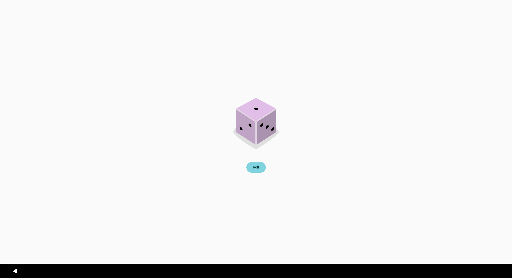

# Dice Roller

A simple Android app built with Kotlin and Jetpack Compose. Tap the **Roll** button and a random dice face (1 to 6) appears.

Built by following the [Android Basics with Compose: Dice Roller codelab](https://developer.android.com/codelabs/basic-android-kotlin-compose-build-a-dice-roller-app).

## Screenshot



## What it demonstrates

- Composable functions (`Column`, `Image`, `Button`, `Spacer`)
- State with `remember` and `mutableStateOf`
- Random number generation with `(1..6).random()`
- Drawable and string resources

## Requirements

- Android Studio (latest stable)
- Android 7.0 (API 24) or higher

## Run it

1. Clone the repo:
```
   git clone https://github.com/YOUR-USERNAME/DiceRoller.git
```
2. Open the folder in Android Studio and let Gradle sync.
3. Press **Run** on an emulator or a connected device.

## Build an APK

**Build > Generate App Bundles or APKs > Generate APKs**

The debug APK is created at `app/build/outputs/apk/debug/app-debug.apk`.

## Credits

Dice images and tutorial by Google, licensed under Apache 2.0 / CC BY 4.0.
